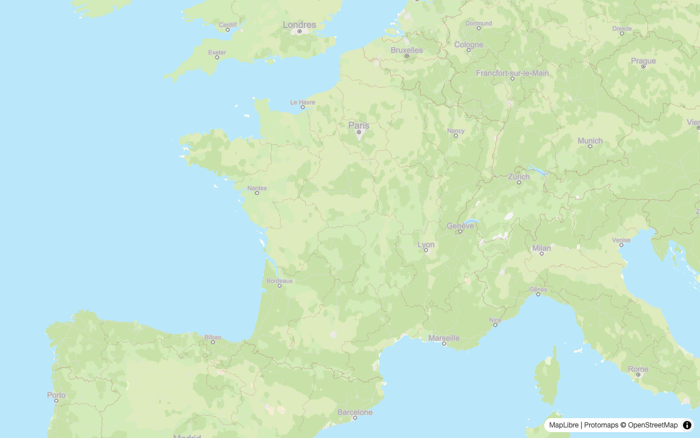
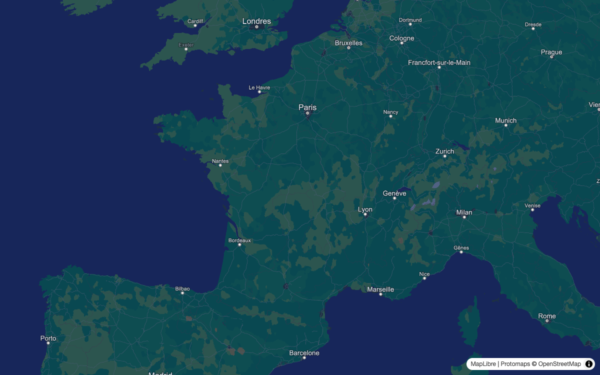
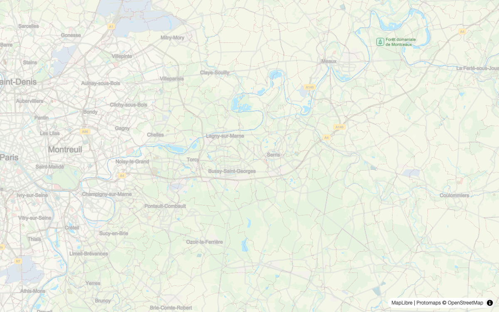
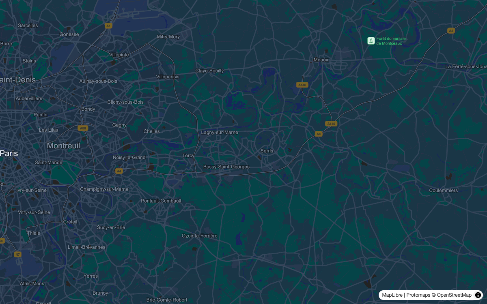
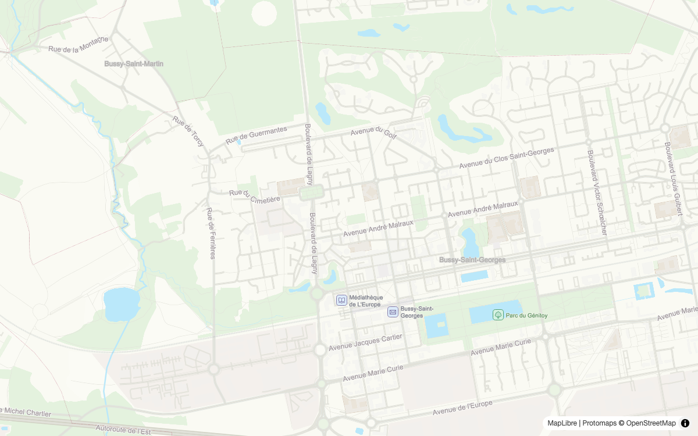
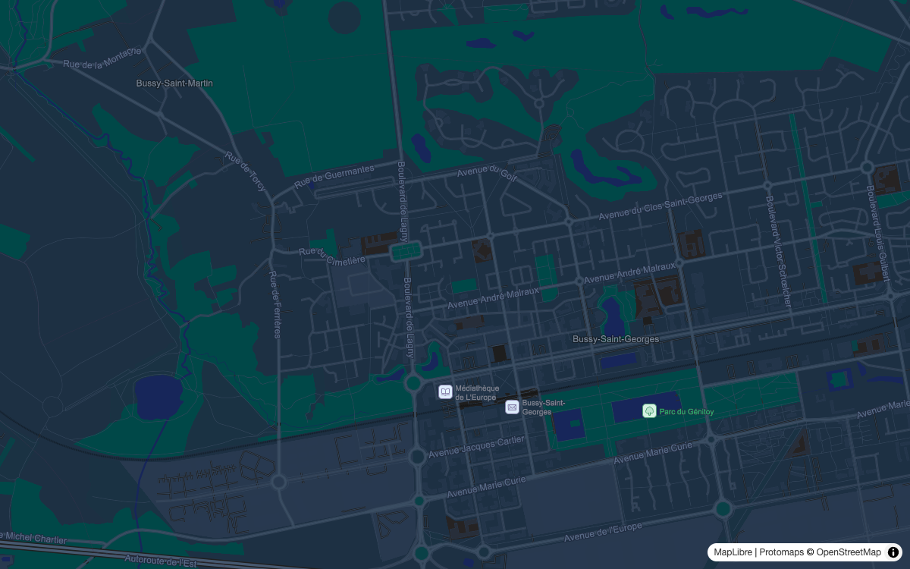

# Protomaps muted flavor

Light and dark [Protomaps](https://github.com/protomaps/basemaps) flavors, with optional helpers for MapLibre.

## Preview

| View | Light | Dark |
| --- | --- | --- |
| France · zoom 5 |  |  |
| Marne-la-Vallée · zoom 10 |  |  |
| Bussy-Saint-Georges · zoom 14 |  |  |

Map data © [OpenStreetMap contributors](https://www.openstreetmap.org/copyright); basemap by [Protomaps](https://protomaps.com/).

## Installation

Copy [protomaps-muted-flavor.ts](protomaps-muted-flavor.ts) into your project. It imports `@protomaps/basemaps` (tested with 5.7.2); your project also needs MapLibre (tested with 5.24.0).

TypeScript-aware tooling must compile this file for the browser. The example uses an import map for `@protomaps/basemaps`.

## Use a flavor

Choose `lightFlavor` or `darkFlavor` and pass it to Protomaps. Create the map as usual:

```ts
import maplibregl from 'maplibre-gl';
import { layers } from '@protomaps/basemaps';
import { lightFlavor, darkFlavor } from './protomaps-muted-flavor.ts';

const flavor = lightFlavor; // or darkFlavor
let mapLayers = layers('basemap', flavor, { lang: 'fr' });

const map = new maplibregl.Map({
  container: 'map',
  style: {
    version: 8,
    sources: {
      basemap: { type: 'vector', url: 'YOUR_VECTOR_SOURCE_URL' },
    },
    layers: mapLayers,
  },
});
```

Provide a Protomaps-compatible vector source and, as needed, attribution, sprites, glyphs and a PMTiles protocol. See the complete [example](example/main.ts).

## Options

The layer helpers return copies. Apply them to `mapLayers` **before** creating the map; combine them in any order.

### Customize colors

Copy the flavor and any nested object you want to change:

```ts
const flavor = {
  ...lightFlavor,
  water: '#aaddff',
  landcover: { ...lightFlavor.landcover!, forest: '#c2ddaa' },
};
```

### Landcover

Fade landcover between zooms 6 and 11. Add a second vector source with `maxzoom: 7` to the map style:

```ts
import { withLandcover } from './protomaps-muted-flavor.ts';

mapLayers = withLandcover(mapLayers, 'landcover');
// In style.sources:
// landcover: { type: 'vector', url: 'YOUR_VECTOR_SOURCE_URL', maxzoom: 7 }
```

### Labels

All options are independent and optional:

```ts
import { withLabels } from './protomaps-muted-flavor.ts';

mapLayers = withLabels(mapLayers, {
  font: 'Arial',                  // Use Arial, Arial Bold and Arial Italic
  hidden: ['places_country'],     // Hide layers by ID
  dense: true,                    // Show more locality, region and subplace labels
  dark: true,                     // Adjust locality, country and water label colors
});
```

The chosen font and its variants must be available to MapLibre.

### Road shields

Replace the road shield layer, then register matching images on the map:

```ts
import { withRoadShields, shieldColors, installRoadShields } from './protomaps-muted-flavor.ts';

const colors = shieldColors.light; // or shieldColors.dark, or your own colors
mapLayers = withRoadShields(mapLayers, colors.text); // before creating the map

// After creating the map:
const stopShields = installRoadShields(map, colors);
```

Images are registered on style load, including after `map.setStyle()`. Call `stopShields()` before removing the map. It removes the listener, not the existing images. To change colors in the same style, stop the listener, remove images `rounded_shield_1` through `rounded_shield_5`, then install again.

### Starfield

Apply a deterministic starfield to the map container. Globe projection remains your choice.

```ts
import { applyStarfield } from './protomaps-muted-flavor.ts';

const removeStars = applyStarfield(document.getElementById('map')!);
// Later: removeStars(); // restores the previous inline background
```

### Edit or add layers

The result is a normal array of MapLibre layer specifications:

```ts
const water = mapLayers.find((layer) => layer.id === 'water');
if (water?.type === 'fill') {
  water.paint = { ...water.paint, 'fill-color': '#aaddff' };
}
```

Insert a custom layer before another layer (or at the end if the ID is absent):

```ts
import { insertLayer } from './protomaps-muted-flavor.ts';

mapLayers = insertLayer(mapLayers, customLayer, 'places_subplace');
```

The example shows a custom continent layer and its GeoJSON source. Canvas is required only for shields and the starfield.

## Run the example

Requires Node.js 22.18 or later. The local server strips TypeScript types in memory. The private `package.json` is only for development; the shared file is not published to npm.

```sh
npm install
npm run dev

# Type-check and run tests
npm test
```

Open `http://127.0.0.1:4178`. Add `?theme=dark` for the dark theme, or `?tiles=URL` for another CORS-enabled PMTiles archive. The local server proxies the default archive.

## Regenerate screenshots

Install Chromium once, then generate the images:

```sh
npx playwright install chromium
npm run screenshots
```

The script starts the example server and creates six 1200 × 750 PNGs in `screenshots/`. It requires network access; map data may change between runs. Set `PLAYWRIGHT_CHROMIUM_EXECUTABLE_PATH` to use an existing Chromium executable. The script generates images without comparing them.
